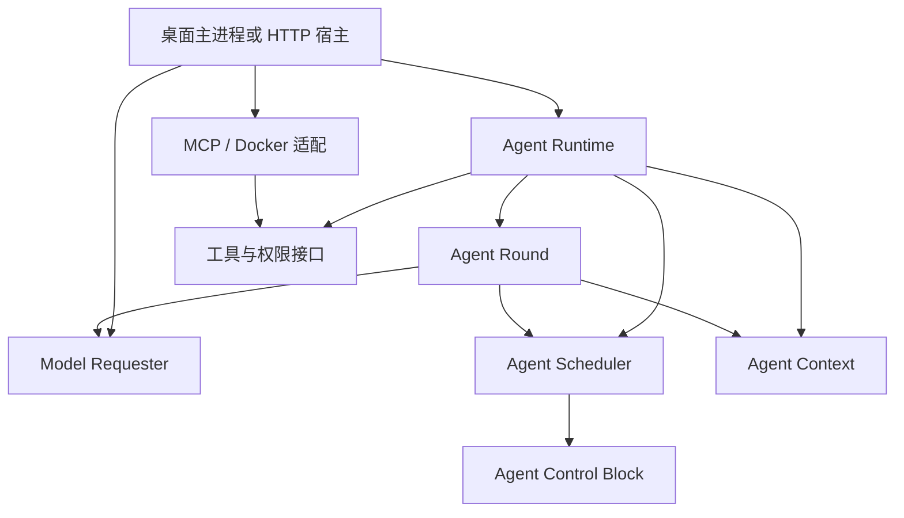

# 3.0.0 模块化审查

审查日期：2026-10-23。范围为本次相对 HEAD 的已跟踪修改及全部新增源码，
包括 Context、ACB、Scheduler、Round、Runtime、会话记忆、模型适配、工具集成、
桌面、HTTP服务、示例及公开入口。按六组阅读并进行跨组契约复核。

## 依赖结论

核心分层维持，没有 UI 向下反向进入核心，也没有新链路依赖旧 TCB 调度器。
原 Server/MCP 对 Runtime 内部 schema 的直接依赖已修复。

图中包含注入端口调用；Scheduler、Requester 的类型接口不会使 Round 装载具体厂商。
ACB 通过 Context 只读端口读取上下文，不维护第二份可写事实源。

| 不变量 | 当前证据 |
| --- | --- |
| 调度器不理解业务任务或模型协议 | 只依赖 ACB 和调度 API，处理运行凭据、操作、事件与批次 |
| 模型层不执行工具或管理权限 | codec/transport 只完成请求转换和响应校验，重试归宿主 |
| 上下文不调用 UI 或供应商 | Context 管理任务、来源、总结、收件与持久化 |
| 工具适配不反向依赖 Runtime 内部 | MCP 使用共享 JSON 校验和 Tool 端口 |
| 桌面与服务器使用公共核心契约 | Runtime/requester/integrations 通过 index 入口使用 |
| 新旧身份和数据不混用 | 应用标识、IPC、数据目录、启动入口分别独立 |
| 私有模型状态不进入聊天和语义记忆 | 原生续接日志按 Agent、会话、工作和上下文范围隔离 |

## 边界修复

- 共享 `types/json-schema.ts` 持有通用 JSON 校验；不加载 Runtime 或业务 Context。
- Runtime 只公开宿主需要的 capability/member/read/search/note 请求校验；
  状态、操作、调度、动作和持久回复 schema 保持内部。
- Server 改用这些公开校验和 integrations 门面，MCP 不再导入 Runtime internal。
- Context 演示自己解释示例协议；只读小说护栏只校验必要数据库字段，不引用内部执行类型。
- 渲染层错误格式化下推独立文件，消除组件与型号选择组件之间的循环引用。
- 临时调试服务上报从发布源码移除；正式错误枚举、事件和持久运行事实保留。

## 协作契约修复

解耦还要求模块之间的完成顺序可靠，本次确认并修复了以下接口问题：

- Round 将准入成功与发送前计数分开，通过供应商无关 `dispatchRequest/beforeSend` 端口协调。
- Context 总结阶段回执与整批输入确认分开；满 inbox 可推进总结，剩余输入仍在可靠批次中。
- Runtime 以总结阶段 ID 保存请求，而非复用调度批次 ID，保证多次压缩的回复来源一致。
- 预算在所有 Context 工作、调度结果、事件和会话批次真正收敛后关闭。
- 写锁覆盖真实执行生命周期；未知结果保留跨 Agent 工作区屏障。
- 对账结果通过稳定调度事件进入 Context，确认前持久保留 pending；重启及容量释放后补投。

## 自动检查

执行 `npm run check:architecture`：

- 核心各模块的依赖方向受白名单限制。
- 跨新模块依赖须通过 index 公共入口。
- 核心不能引用桌面、Electron或React。
- renderer、shared与preload不能直接引用核心源码，新桌面不能引用旧桌面。

发布前79个生产源码文件通过。9个包入口实测可导入，外部直接读取 internal 路径
被 exports 拒绝。白盒测试可读取实现用于验证，不能据此扩大生产模块的公开接口。

## 剩余边界

Runtime 是组合根，内部会话与执行模块较多，但没有把这些职责推入 Scheduler 或模型层。
来源提取仍识别规范化事件名，改变事件结构时须同步公共语义约定。
桌面快照仍携带完整历史，后续可在宿主层做增量和分页，无需修改核心调度语义。

全仓416项测试通过；跨组修复复核在限定路径内未发现剩余P0-P2。
这是当前源码与离线恢复路径的证据，不替代真实Docker、Linux或Windows实机验收。
